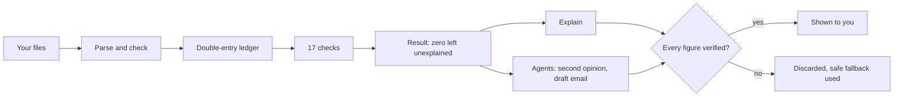
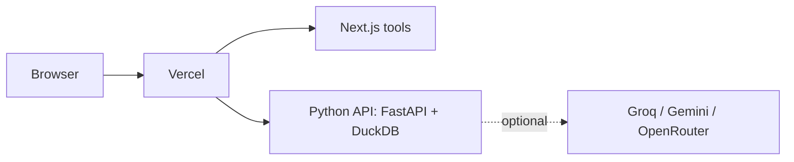

# Residual

Settlement tools for merchants. Upload your Razorpay report and bank statement, see where your money went.

**Live:** [residual-beta.vercel.app](https://residual-beta.vercel.app) · free · nothing you upload is stored

## The problem

A merchant captures ₹8.9 lakh in a week and ₹7.7 lakh reaches the bank. The difference is fees, GST, TDS, refunds, disputes, holds and T+2 timing — and sometimes a payout that never arrived. Finding out which, by hand, from two exports that don't share a key, takes a day. I wanted it to take a few seconds and be provably right.

## The tools

| Tool | What it does |
|---|---|
| Settlement Reconciler | Breaks the gap between captured and banked into its causes |
| Missing Payout Finder | Finds payouts the gateway sent that never reached your bank |
| Fee Checker | Checks every fee against your contracted rate |
| GST Credit Checker | Finds GST you paid but can't claim yet |
| Statement Reader | Turns a bank statement into a clean table that checks against its own running balance |
| Ask Your Ledger | Answers any question about your payments, and shows the query behind every answer |

Files come in the shape people actually have them. The gateway report as the dashboard downloads it (CSV or Excel) or as the API returns it (JSON). Bank statements as PDF — long ones with cover pages, terms pages, the header on page one only, wrapped lines, newest-first, password-protected — or Excel (`.xlsx`, `.xls`, or the HTML tables some banks save as `.xls`) or CSV in any delimiter and encoding. GSTR-2B as the portal's JSON or Excel.

Reconciler, Missing Payout Finder and the dashboard need the bank statement too — a payout can only be called missing if it's absent from the bank's own record, not the gateway's. A statement for other dates is refused by name; one that stops early only judges the payouts it covers.

Each result says what went in, what was checked, what needs chasing, and what it assumed — so if an assumption is wrong for you, you can see it. Tables download as CSV that opens cleanly in Excel.

The **dashboard** puts a whole quarter on one page: how much of the gap you can actually get back, how your fee rate moved against your contract (it flags the week a hike started), and a ranked action plan — each step with an amount, a deadline (the GST claim turns urgent as its Section 16(4) date nears) and, where there's someone to write to, a drafted email. It exports as a one-page PDF report: problem, data, findings, root causes, recommendations.

## Try it without your own data

Every tool has at least three sample sets under it — a clean period, a missing payout (also with its statement as a 5-page PDF), card fees above contract, GST credit that can't be claimed, five bank layouts, an Excel statement, a password-locked PDF (password `HDFC1234`). Click **Run it**, or download the files and drop them in.

They aren't canned results. Running a sample uploads the real files and processes them the same way as yours, so if you download one and change it — delete a payout from the bank statement, lower the contracted card rate — the answer changes with it. There's a test for exactly that.

The samples are generated by `scripts/make_samples.py`; a test regenerates them and fails if the published copies have drifted.

## Decisions I made

**The answer is arithmetic, not a guess.** Every payment becomes double-entry bookkeeping, so the gap *has* to equal the movement of every other account. If anything is left unexplained, that's a bug, not a judgement call. Every week in the benchmark closes to ₹0.00.

**AI never produces a number.** The models only word explanations, write queries, and draft emails. Every figure they write is checked against what the books returned — if a model invents an amount or a UTR, its version is thrown away.

**Any model, with a fallback.** Agents go through one router: Groq first, then Gemini, then OpenRouter. If one is down, rate-limited or has retired its model, the next one answers, and if all fail the built-in analyst takes over. Model names are env vars, so a retired model is a config change.

**Agents do the follow-up work.** The investigator is a tool-calling agent: told only that the books are short, it measures accounts with its own tools until it can propose a cause, and the verifier accepts it only if the books then close. Before a payout is called missing, an agent searches every credit on the statement for it — by reference, by the tail of the reference a bank might keep, and by amount. Ask turns a question into one read-only query and, if that query fails, reads the error and fixes it once. Drafts are written for whoever has to act — payout trace, fee dispute, the gateway's missing GST invoices — ready to copy.

**Nothing is kept.** Files live in memory for 45 minutes and are gone. There's no login because there's nothing to log into.

## How it works





## Does it hold up

| | |
|---|---|
| Weekly closes reaching ₹0.00 unexplained | 13 / 13 |
| Causes the agent traced on its own | 87 / 87 |
| Fault-injection runs with every invariant holding | 3,000 |
| Tests | 717 |

I also ran it against real Razorpay test-mode payments. That caught a bug the simulated data never would: Razorpay reports its fee *including* GST, and I was counting the GST twice. Four real payments, four banks, all at exactly 2.0000% once fixed.

## Run it locally

```bash
uv sync --all-extras && npm install
npm run api     # engine on :8000
npm run dev     # tools on :3000
```

No API key needed — without one, explanations and drafts come from the verified figures and the built-in analyst runs the agents. Add `GROQ_API_KEY`, `GEMINI_API_KEY` or `OPENROUTER_API_KEY` to `.env` for model-written ones.

To see what the models actually do, `uv run python scripts/check_ai.py` uploads the samples to the live site (or pass a local URL) and reports, for every explanation, query, draft and investigation, which model answered, how long it took and whether its figures held up.

**Stack:** Python, DuckDB, FastAPI, Next.js, TypeScript, Tailwind, Vercel.

## What's left

- Benchmark each model's root-cause accuracy against the built-in analyst on the 87 injected causes
- Show real progress from the server instead of timed steps
- Read scanned statements (needs OCR)
- Read the statement's own declared period, not just its first and last rows
- Support gateways other than Razorpay

## Licence

MIT
